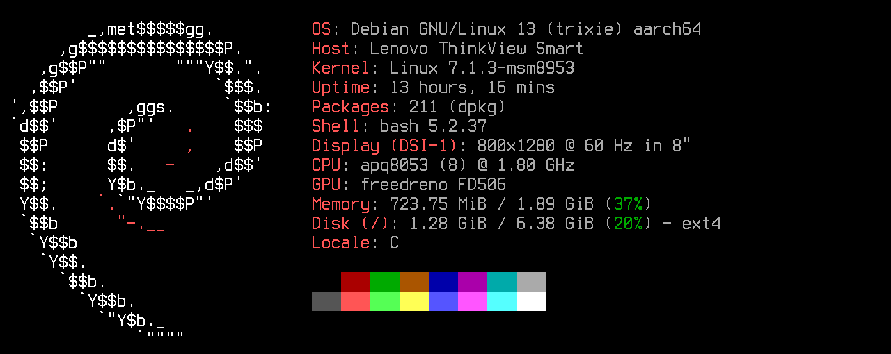

# 🖥️ ThinkSmart View Linux

Run a minimal **Debian 13** on the **Lenovo ThinkSmart View** (CD-18781Y, the 8" Teams/Zoom desk display), with
working **screen, touch, speaker, microphones, Wi-Fi and sensors**. No Android, no browser: a clean Linux base with no
desktop, for whatever you want to build on it — a voice assistant, a smart-home panel, a clock, a kiosk.

[](https://github.com/m0s4ik/thinksmart-view-linux/releases)
[](https://github.com/m0s4ik/thinksmart-view-linux/actions/workflows/ci.yml)
[](https://www.debian.org)
[](docs/kernel.md)
[](docs/hardware.md)
[](LICENSE)
[](https://buymeacoffee.com/m0s4ik)

<a href="docs/install.md">Installation guide 🚀</a> | <a href="docs/hardware.md">Hardware</a> |
<a href="docs/flashing.md">Flashing over EDL</a> | <a href="docs/known-issues.md">Known issues</a>

**⭐ If you have one of these devices gathering dust, give it a second life, and star the repo if it helps!**

If this project saved you some time, you can also
[buy me a coffee ☕](https://buymeacoffee.com/m0s4ik): it keeps the next one coming.

<p align="center"></p>
<p align="center"><sub><code>fastfetch</code> on the device, drawn in landscape with the console font (Terminus).</sub></p>

## What works

| | |
|---|---|
| 🖥️ **Display** | 800×1280 Himax panel, framebuffer `/dev/fb0`, backlight 0-4095 |
| ✋ **Touch** | Himax touchscreen (evdev) |
| 🎮 **GPU** | Adreno 506 with a reduced Mesa (freedreno, OpenGL ES 3.1, EGL/GBM, no LLVM): 60 fps with vsync |
| 🔊 **Speaker** | TAS5782M amplifier with the out-of-tree driver, hardware volume (`Speaker Amp Master`) |
| 🎙️ **Microphones** | two digital microphones, ready for wake word and speech recognition |
| 📶 **Wi-Fi** | QCA9379 (ath10k), NetworkManager profile from the build config |
| 🧭 **Sensors and keys** | BMA253 accelerometer (rotation), VCNL4200 ambient light, Vol+ / Vol− keys, camera shutter switch |
| 🔒 **Access** | ssh with keys only, nftables firewall open only to your LAN |
| 🚀 **Headless boot** | ready in ~30 s, survives without a keyboard (no emergency-mode dead ends) |
| 🧩 **Your app on top** | a customization hook adds your application to the image at build time |

Not yet: camera (sensor driver missing), suspend. See [known issues](docs/known-issues.md).

## Installation

> [!NOTE]
> **Requirements:** a ThinkSmart View CD-18781Y (tested on the Himax panel variant), a USB-A to USB-C cable, a
> Debian/Ubuntu machine (or VM) with root and ~20 GB free (EDL backup, image build, kernel source and Mesa build).

> [!WARNING]
> Installing rewrites the eMMC. The guide starts with a **full backup over EDL**, the only way back to the Lenovo
> firmware.

There is no ready-made image: it would contain your Wi-Fi password and ssh keys, and the kernel and firmware come from
postmarketOS and your own device. After putting the parts in `image/parts/` (kernel files, speaker driver, Mesa: see
the guide), you build it with one script:

```bash
git clone https://github.com/m0s4ik/thinksmart-view-linux.git
cd thinksmart-view-linux
cp image/config.env.example image/config.env && chmod 600 image/config.env   # Wi-Fi, ssh key, time zone, firewall
sudo ./image/build.sh image/config.env                                         # ~10 min, ends with VERIFY OK
```

The full walkthrough (backup, lk2nd, kernel files, speaker driver, Mesa, build, flashing) is in the
**[installation guide 📚](docs/install.md)**.

## Documentation

| | |
|---|---|
| [Installation guide](docs/install.md) | from a sealed device to Debian over ssh, step by step |
| [Flashing over EDL](docs/flashing.md) | backup, lk2nd, repartitioning, writing the image, going back |
| [Kernel and device files](docs/kernel.md) | where kernel, initramfs, firmware and UCM come from |
| [Boot](docs/boot.md) | image layout, system services, the headless-boot fixes |
| [Hardware](docs/hardware.md) | panel, audio, Wi-Fi, sensors, keys, camera |
| [Known issues](docs/known-issues.md) | what does not work (yet) |
| [`image/`](image/README.md) · [`driver/tas5782m/`](driver/tas5782m/README.md) | the build script and its customization hook, the speaker driver |

## Roadmap

- [x] Debian 13 image on the postmarketOS 7.1.3 kernel, headless boot
- [x] Speaker, microphones, Wi-Fi, touch, accelerometer, light sensor, keys
- [x] Customization hook for applications
- [x] Hardware volume of the TAS5782M amplifier
- [ ] Faster boot (initramfs framebuffer wait)
- [ ] Front camera (S5KC505A)
- [ ] FT8201 panel variant

## Credits

This project stands on the work of others:

- **[rickx/ubuntu-thinksmart](https://github.com/rickx/ubuntu-thinksmart)**: the TAS5782M driver, lk2nd and bootstrap
  images, the repartitioning script, and the research that made Linux on this device practical.
- **[jethac/lenovo-thinksmart-view](https://github.com/jethac/lenovo-thinksmart-view)**: mainline work on the device,
  panel drivers and the camera (S5KC505A) analysis and driver.
- **[msm8953-mainline](https://github.com/msm8953-mainline)**: the kernel.
- **[postmarketOS](https://postmarketos.org)**: kernel package, initramfs, firmware packaging, msm-firmware-loader,
  UCM profiles.
- **[lk2nd](https://github.com/msm8916-mainline/lk2nd)** and **[bkerler/edl](https://github.com/bkerler/edl)**.

## License

Copyright (C) 2026 Andrea Mattera.

- **GPL-3.0-or-later** for everything written for this project (`image/`, `docs/`): see [LICENSE](LICENSE). Source
  files carry an `SPDX-License-Identifier: GPL-3.0-or-later` header.
- **GPL-2.0-only** for the TAS5782M kernel driver in [`driver/tas5782m/`](driver/tas5782m/), a modified copy of
  rickx's driver (changes listed in [driver/tas5782m/README.md](driver/tas5782m/README.md#changes-2026-11-03)), and
  its `install-module.sh`: like any Linux kernel module it stays under the kernel's license (GPL-2.0-only is not
  compatible with GPL-3.0). See [driver/tas5782m/LICENSE](driver/tas5782m/LICENSE).
- [`kernel/config-7.1.3-msm8953`](kernel/config-7.1.3-msm8953) is the kernel configuration of the postmarketOS
  package `linux-postmarketos-qcom-msm8953` (GPL-2.0).
- `image/rootfs/usr/local/sbin/msm-firmware-loader.sh` is an unmodified copy from postmarketOS under the MIT license.
- **Built images** also contain third-party components under their own licenses: Debian packages, Mesa (MIT and
  others), the postmarketOS kernel, initramfs, firmware and UCM profiles. The firmware is proprietary and the image
  holds your secrets (Wi-Fi password, ssh host keys): **do not redistribute built images**.

Not affiliated with Lenovo. ThinkSmart is a trademark of Lenovo.
