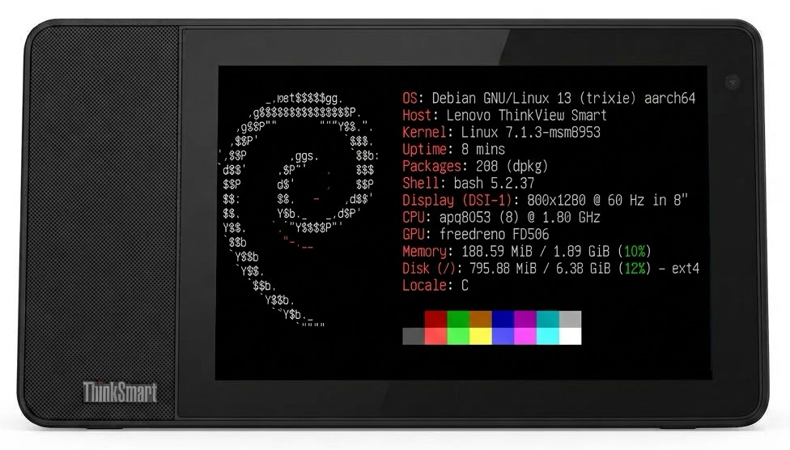

# 🖥️ ThinkSmart View Debian

Run an **ultra-light Debian 13** on the **Lenovo ThinkSmart View** (CD-18781Y, the 8" Teams/Zoom desk display), with
working **screen, touch, GPU, speaker, microphones, Wi-Fi, sensors and hardware video decoder**. No Android, no
browser: a clean Linux base with no desktop, for whatever you want to build on it — a voice assistant, a smart-home
panel, a clock, a kiosk. Two optional layers add what some applications need: a web engine (WPE WebKit) to show web
pages, and the GStreamer runtime of an AirPlay receiver (UxPlay) for music and screen mirroring.

<p align="center"></p>
<p align="center"><sub>The ThinkSmart View running this system: the real <code>fastfetch</code> output (v0.1, no application
running). This project is not affiliated with or endorsed by Lenovo; ThinkSmart is a trademark of its owner.</sub></p>

[](https://github.com/m0s4ik/thinksmart-view-debian/releases)
[](https://github.com/m0s4ik/thinksmart-view-debian/actions/workflows/ci.yml)
[](https://www.debian.org)
[](docs/kernel.md)
[](docs/hardware.md)
[](LICENSE)
[](https://buymeacoffee.com/m0s4ik)

<a href="docs/install.md">Installation guide 🚀</a> | <a href="docs/hardware.md">Hardware</a> |
<a href="docs/flashing.md">Flashing over EDL</a> | <a href="docs/known-issues.md">Known issues</a>

**⭐ If you have one of these devices gathering dust, give it a second life, and star the repo if it helps!**

If this project saved you some time, you can also
[buy me a coffee ☕](https://buymeacoffee.com/m0s4ik): it keeps the next one coming.

## Why this one

Built to be **as light as possible**, so that the 2 GB of RAM and the eight small Cortex-A53 cores are left to your
application:

| | |
|---|---|
| 🪶 **~190 MB of RAM** | used by the whole system, kernel included, with no application running: ~1.7 GB left for yours |
| 📦 **218 Debian packages** | ~470 MB on disk with kernel modules and GPU drivers; the compressed image is ~185 MB |
| ⚙️ **A handful of services** | systemd, journald, udev, NetworkManager, wpa_supplicant, ssh, timesyncd, nftables, avahi (mDNS), plus the audio and light sensor setup. No desktop, no display server, no browser |
| ⏱️ **~24 s boot** | from power on to ssh (16 s kernel and initramfs, 7 s userspace) |
| 🎮 **GPU without the weight** | Mesa built for this GPU only and without LLVM: ~22 MB instead of the ~170 MB of Debian's Mesa |
| 🧱 **Plain Debian** | apt and Debian's security updates, systemd, nothing custom to learn; the whole image comes from one script you can read |

<sub>RAM and boot time measured on our device on 2026-11-04, right after flashing v0.1, with no application running
(the picture above; v0.1 had 208 packages, before avahi). Packages and disk: a test build of v0.3-rc3 with the
optional layers off.</sub>

## What works

| | |
|---|---|
| 🖥️ **Display** | 800×1280 Himax panel, framebuffer `/dev/fb0`, backlight 0-4095 |
| ✋ **Touch** | Himax touchscreen (evdev) |
| 🎮 **GPU** | Adreno 506 with a reduced Mesa 26.3 (freedreno, OpenGL ES 3.1, EGL/GBM, Wayland platform, no LLVM): 60 fps with vsync |
| 🎞️ **Video decoder** | Venus hardware decoder (H.264, HEVC, VP8, VP9, MPEG-2/4) through V4L2, with a rebuilt `venus-core` module: 1080p30 H.264 with ~5% of one core |
| 🌐 **Web (optional)** | WPE WebKit 2.54 on the GPU with its sandbox, for an application that shows web pages (`WEB=1`) |
| 📡 **AirPlay runtime (optional)** | GStreamer plugins and libraries for an AirPlay receiver built on UxPlay, shipped by the application (`AIRPLAY=1`) |
| 🔊 **Speaker** | TAS5782M amplifier with the out-of-tree driver, hardware volume (`Speaker Amp Master`), 16-bit playback |
| 🎙️ **Microphones** | two digital microphones, ready for wake word and speech recognition |
| 📶 **Wi-Fi** | QCA9379 (ath10k), NetworkManager profile from the build config |
| 🧭 **Sensors and keys** | BMA253 accelerometer (rotation), VCNL4200 ambient light and proximity, Vol+ / Vol− keys, camera shutter switch |
| 🔒 **Access** | ssh with keys only, nftables firewall open only to your LAN |
| 🌙 **Suspend** | `systemctl suspend`: under 0.5 W, Vol+ / Vol− or an RTC alarm wake it |
| 🚀 **Headless boot** | ready in ~25 s, survives without a keyboard (no emergency-mode dead ends) |
| 🧩 **Your app on top** | a customization hook adds your application to the image at build time |

Not yet: camera (sensor driver missing). `poweroff` does not stay off with the power supply plugged in (use suspend,
or `systemctl halt` before unplugging). See [known issues](docs/known-issues.md).

## What's new in v0.3

> [!IMPORTANT]
> **Release candidate.** The v0.3 release candidates ship **Mesa 26.3.0-rc3**, the version the web layer was tested
> with on the device; v0.3 comes when Mesa 26.3.0 final is out.

- **Mesa 26.3** as a Debian package (`mesa-freedreno`) in `/usr`, behind Debian's libglvnd, with the **Wayland
  platform** (needed by WPE WebKit). It stands in for Debian's `libgbm1` and `libegl-mesa0`, so apt never pulls
  Debian's Mesa and LLVM. Still no LLVM, X11, Vulkan or video ([docs/kernel.md](docs/kernel.md#mesa)). *(rc1)*
- **Optional web layer** (`WEB=1`): WPE WebKit 2.54, backported to Debian 13 by `image/build-wpe.sh`, with bubblewrap
  for its sandbox ([image/README.md](image/README.md#web-layer-optional)). *(rc1)*
- **Firewall rules of applications** in `/etc/nftables.d/*.nft`, and **mDNS** with avahi (`<hostname>.local`,
  service announcements). *(rc2)*
- **Hardware video decoder**: `venus-core` rebuilt with the mainline HFI parser ([driver/venus](driver/venus/README.md));
  the kernel package's one does not start. *(rc3)*
- **Audio**: playback is converted to 16 bit, because 24-bit playback was silent (decoders that output 32 bit, like
  GStreamer's libav ones, played nothing). *(rc3)*
- **Optional AirPlay runtime** (`AIRPLAY=1`): the GStreamer plugins and libraries an AirPlay receiver built on UxPlay
  needs, nothing else ([image/README.md](image/README.md#airplay-runtime-optional)). *(rc3)*
- Known: freedreno loops forever on some browser render targets; run the web engine with `FD_MESA_DEBUG=sysmem`
  ([known issues](docs/known-issues.md#gpu-and-web-layer)).

## Installation

> [!NOTE]
> **Requirements:** a ThinkSmart View CD-18781Y (tested on the Himax panel variant), a USB-A to USB-C cable, a
> Debian/Ubuntu machine (or VM) with root and ~20 GB free (EDL backup, image build, kernel source and Mesa build).

> [!WARNING]
> Installing rewrites the eMMC. The guide starts with a **full backup over EDL**, the only way back to the Lenovo
> firmware.

There is no ready-made image: it would contain your Wi-Fi password and ssh keys, and the kernel and firmware come from
postmarketOS and your own device. After putting the parts in `image/parts/` (kernel files, speaker driver, Mesa: see
the guide), you build it with one script:

```bash
git clone https://github.com/m0s4ik/thinksmart-view-debian.git
cd thinksmart-view-debian
cp image/config.env.example image/config.env && chmod 600 image/config.env   # Wi-Fi, ssh key, time zone, firewall
sudo ./image/build.sh image/config.env                                         # ~10 min, ends with VERIFY OK
```

The full walkthrough (backup, lk2nd, kernel files, speaker driver, Mesa, build, flashing) is in the
**[installation guide 📚](docs/install.md)**.

## Documentation

| | |
|---|---|
| [Installation guide](docs/install.md) | from a sealed device to Debian over ssh, step by step |
| [Flashing over EDL](docs/flashing.md) | backup, lk2nd, repartitioning, writing the image, going back |
| [Kernel and device files](docs/kernel.md) | where kernel, initramfs, firmware and UCM come from |
| [Boot](docs/boot.md) | image layout, system services, the headless-boot fixes |
| [Hardware](docs/hardware.md) | panel, audio, Wi-Fi, sensors, keys, camera |
| [Known issues](docs/known-issues.md) | what does not work (yet) |
| [`image/`](image/README.md) | the build script, its options (web layer, AirPlay runtime) and customization hook |
| [`driver/`](driver/) | the speaker driver ([tas5782m](driver/tas5782m/README.md)), the light sensor ([vcnl4000](driver/vcnl4000/README.md)) and video decoder ([venus](driver/venus/README.md)) modules, the experimental [thinksmart-poweroff](driver/thinksmart-poweroff/README.md) |

## Roadmap

- [x] Debian 13 image on the postmarketOS 7.1.3 kernel, headless boot
- [x] Speaker, microphones, Wi-Fi, touch, accelerometer, light and proximity sensor, keys
- [x] Customization hook for applications
- [x] Hardware volume of the TAS5782M amplifier
- [x] Mesa 26.3 in `/usr` with the Wayland platform; optional web layer (WPE WebKit 2.54)
- [x] Suspend, woken by the volume keys
- [x] Hardware video decoder (Venus); optional AirPlay runtime
- [ ] Mesa 26.3.0 final (v0.3)
- [ ] Fix for the freedreno GMEM loop, proposed upstream
- [ ] `poweroff` that stays off with the supply plugged in
- [ ] Faster boot (initramfs framebuffer wait)
- [ ] Front camera (S5KC505A)
- [ ] FT8201 panel variant

## Credits

This project stands on the work of others:

- **[rickx/ubuntu-thinksmart](https://github.com/rickx/ubuntu-thinksmart)**: the TAS5782M driver, lk2nd and bootstrap
  images, the repartitioning script, and the research that made Linux on this device practical.
- **[jethac/lenovo-thinksmart-view](https://github.com/jethac/lenovo-thinksmart-view)**: mainline work on the device,
  panel drivers and the camera (S5KC505A) analysis and driver.
- **[msm8953-mainline](https://github.com/msm8953-mainline)**: the kernel.
- **[postmarketOS](https://postmarketos.org)**: kernel package, initramfs, firmware packaging, msm-firmware-loader,
  UCM profiles.
- **[lk2nd](https://github.com/msm8916-mainline/lk2nd)** and **[bkerler/edl](https://github.com/bkerler/edl)**.

## License

Copyright (C) 2026 Andrea Mattera.

- **GPL-3.0-or-later** for everything written for this project (`image/`, `docs/`): see [LICENSE](LICENSE). Source
  files carry an `SPDX-License-Identifier: GPL-3.0-or-later` header.
- **GPL-2.0-only** for the kernel code in [`driver/`](driver/): the TAS5782M driver, a modified copy of rickx's
  driver (changes listed in [driver/tas5782m/README.md](driver/tas5782m/README.md#changes-2026-11-03)), and its
  `install-module.sh`; `thinksmart-poweroff`; the build files and `hfi_parser.patch` of the venus and vcnl4000
  modules (they build the kernel's own sources). Like any Linux kernel module they stay under the kernel's license
  (GPL-2.0-only is not compatible with GPL-3.0). See [driver/tas5782m/LICENSE](driver/tas5782m/LICENSE).
- [`kernel/config-7.1.3-msm8953`](kernel/config-7.1.3-msm8953) is the kernel configuration of the postmarketOS
  package `linux-postmarketos-qcom-msm8953` (GPL-2.0).
- `image/rootfs/usr/local/sbin/msm-firmware-loader.sh` is an unmodified copy from postmarketOS under the MIT license.
- **Built images** also contain third-party components under their own licenses: Debian packages, Mesa (MIT and
  others), the postmarketOS kernel, initramfs, firmware and UCM profiles. The firmware is proprietary and the image
  holds your secrets (Wi-Fi password, ssh host keys): **do not redistribute built images**.

This project is not affiliated with or endorsed by Lenovo. Lenovo and ThinkSmart are trademarks of their owner.
